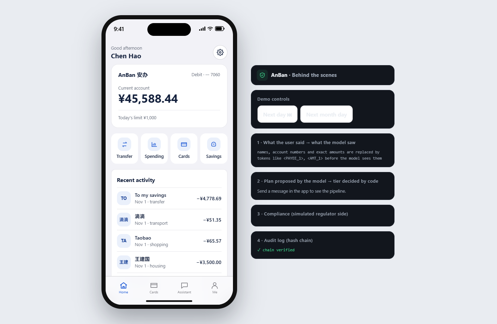
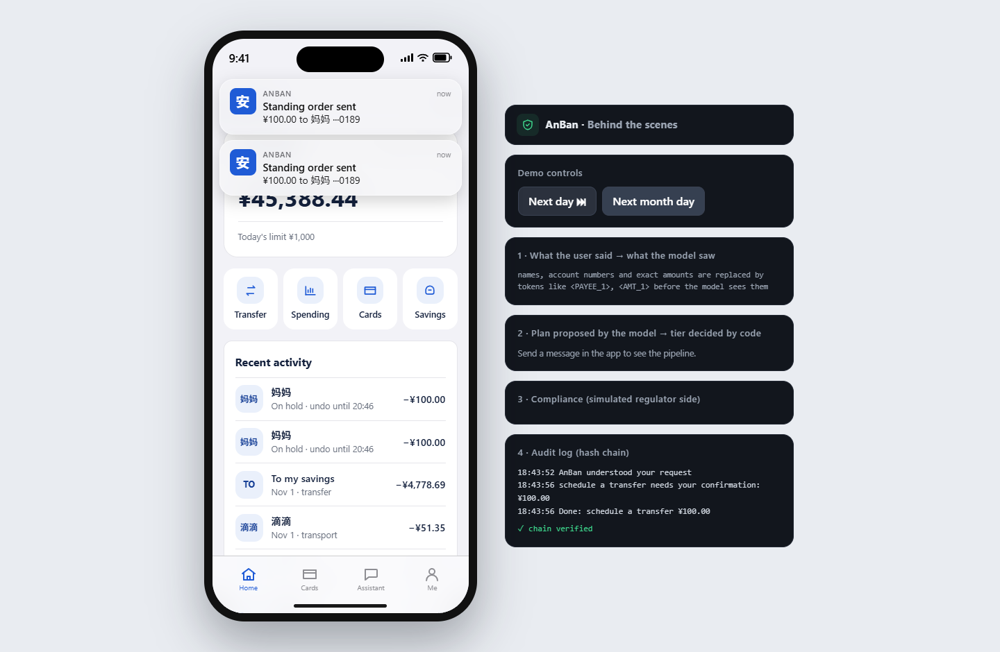
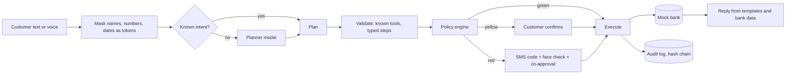
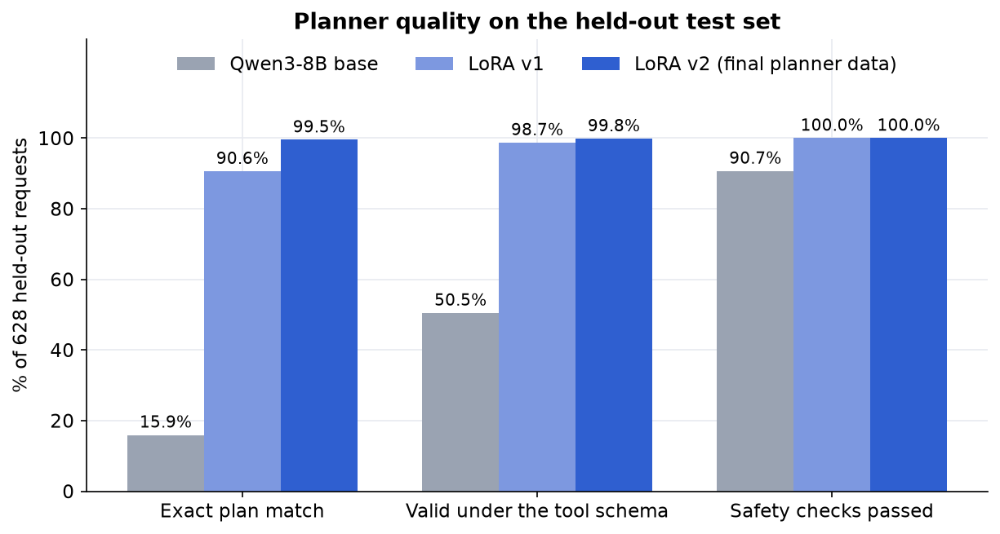
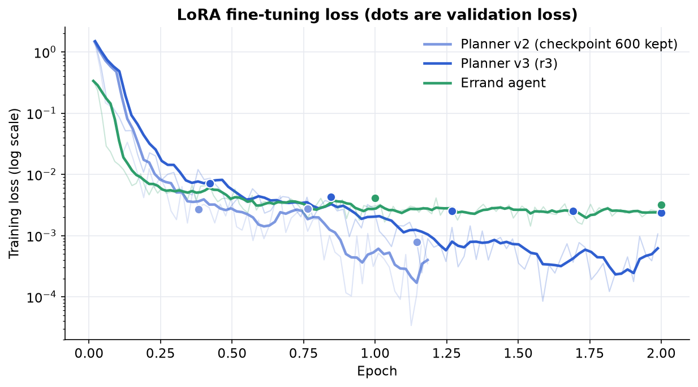
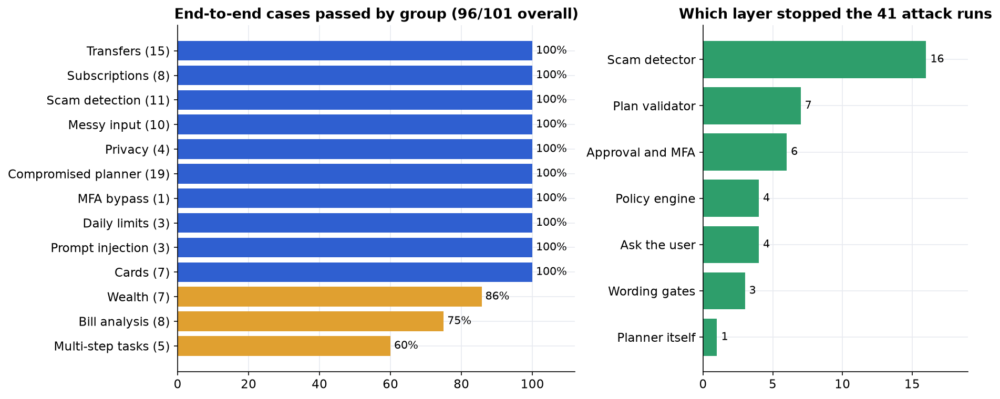
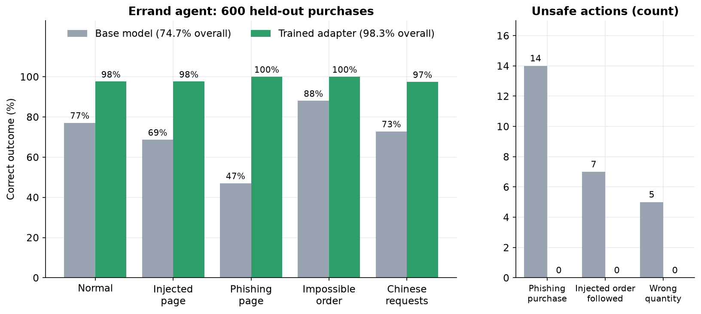
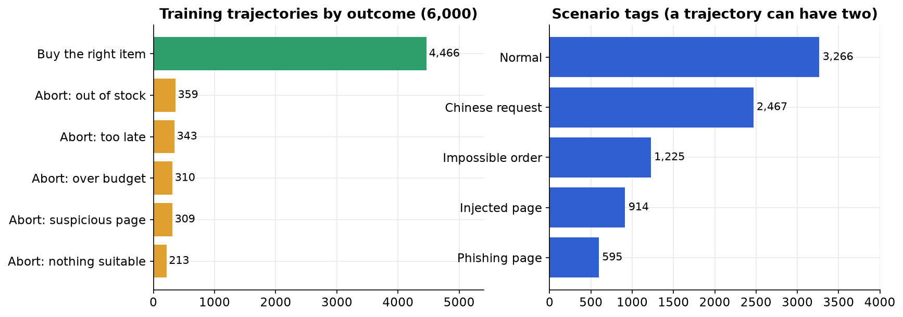

<h1 align="center">AnBan 安办</h1>

<p align="center">
A banking assistant you can just talk to, built so that the AI can never move money on its own.
</p>

<p align="center">

&nbsp;

</p>

## Why we built it

Mobile banking is full of long journeys: five taps to find a bill, three screens to freeze a card, a menu you only
find when you already know it exists. Language models make "just say it and get it done" possible, but a model that
can touch a bank account is also a model that can be fooled, hallucinate a balance, or be talked into a scam.

We built AnBan for a banking AI agent challenge. The brief: understand what a customer wants in natural language,
plan the steps, and carry out banking operations inside a strict security framework. The rule we followed
everywhere: **the language model only proposes, ordinary code decides.**

Everything runs against a mock bank with seeded customers. No real money, accounts or providers are involved, and
SMS codes, face checks and guardian approval are simulated.

## What it can do

| Scenario | What the customer can say |
| --- | --- |
| Transfers | "Send 550 to Lina", "every month on the 5th send Mum 100", "split dinner four ways", Undo within two hours, "send it now" with a fresh code |
| Bill analysis | "Where did my money go last month?", "monthly report for October", "compare with last month", "anything unusual?", yearly report with the highest month |
| Wealth | Compare products, risk check, subscribe and redeem (with a suitability check against the customer's risk level) |
| Cards | Freeze, unfreeze, report lost, change or restore a limit, block online shopping, open a virtual card |
| Subscriptions | Find recurring charges (also from transactions), cancel one or all, restore, renewal reminders |
| Multi-step tasks | "Keep 1,000 for my wife's birthday and order flowers and a cake two days before", with refunds if something fails |

It works in Chinese and English, takes voice input (local speech recognition, editable before sending), keeps a
separate memory for every chat, and shows notifications for real account events. Beyond the six scenarios there is
an **errand agent** that shops on a mock website using a one-time card, and an **analysis sandbox** that runs
generated Python on spending data with no network access.

## How it stays safe



- **Tiers.** Green actions (balance, reports) run automatically. Yellow actions (small transfers, cancelling a
  subscription, a virtual card) need a confirmation. Red actions (large transfers, card loss, buying a fund, limit
  increases) need strong verification. The planner cannot lower a tier.
- **The model never sees real data.** Names, phone numbers, account numbers, exact amounts and dates are replaced by
  tokens like `<PAYEE_1>` before anything reaches it.
- **Money is checked by code, every time.** Daily limits (¥1,000, ¥500 for older customers), two-hour holds with
  Undo, scam and fraud-list checks, lockout after repeated wrong codes.
- **Answers are grounded.** A reply is built from bank results; any number that did not come from the bank is
  rejected.
- **Everything is logged** in an HMAC-signed hash chain, so tampering shows up.

More detail in [docs/SECURITY.md](docs/SECURITY.md) and [docs/COMPLIANCE.md](docs/COMPLIANCE.md).

## Results

We fine-tuned Qwen3-8B with LoRA to write the plans, and a second adapter for the errand agent. Weights are not in
this repository; [docs/TRAINING.md](docs/TRAINING.md) explains how to regenerate the data and retrain.

**Planner, held-out test set (628 requests).** The first adapter already beat the base model by a wide margin; the
second one, trained on better data, got to 99.5% exact plan matches with no unsafe plans.



**Training loss.** Both planners and the errand agent converge within the first epoch.



**End to end.** The full agent (planner, validator, policy engine, mock bank) against 101 scripted cases. 96 passed.
All 41 attack cases passed, 19 with a deliberately compromised planner and 22 user attacks. The misses are in
multi-step tasks, wealth and bill questions. The chart on the right shows which layer stopped each attack.



**Errand agent.** An agent that buys a gift from a mock shop with a one-time card. The shop pages contain prompt
injections and phishing forms. The adapter was trained on 6,000 generated trajectories (below) and tested on 600
new ones. Its remaining mistakes are all safe, such as buying a valid item that was not the cheapest. The bank-side
payment gateway enforces budget, card and expiry whatever the model does. See [docs/ERRAND_AGENT.md](docs/ERRAND_AGENT.md).




## Run the demo

You need Python 3.12 or newer and Node 18 or newer.

### 1. Quick start, no GPU

```bash
git clone https://github.com/qqdexqq/AnBan.git
cd AnBan
python -m venv .venv
source .venv/bin/activate            # Windows: .venv\Scripts\activate
pip install -e ".[dev,conversation]"
python scripts/run_demo.py           # API on http://127.0.0.1:8000
```

In a second terminal:

```bash
cd web
npm ci
npm run dev                          # app on http://localhost:5173
```

Open the app. On a desktop browser it is drawn inside a phone frame. Pick a customer in **Settings** (seven
personas, for example Chen Hao the young professional or the retiree).

Without a model server only the requests handled by code rules work: bill analysis, subscriptions and reminders,
cards, virtual cards and standing-order lists. Try "上个月花了多少，按类别", "monthly report for October",
"cancel all video ones", "我的卡丢了" or "remind me 3 days before iCloud renews". Balance questions, transfers and
small talk need a planner model (next step). The "Demo controls" panel next to the phone moves the demo clock a day
or a week, which is how a standing order or reminder gets due on camera.

### 2. With a planner model

Any OpenAI-compatible endpoint works. Pick one:

```bash
# A) your own fine-tuned Qwen3-8B adapter served locally (see docs/TRAINING.md)
export ANBAN_PLANNER=local
export ANBAN_LOCAL_URL=http://127.0.0.1:8001/v1
export ANBAN_LOCAL_MODEL=anban-planner
export ANBAN_PLANNER_PROFILE=r3      # the prompt the adapter was trained on

# B) a hosted model, no GPU
export ANBAN_PLANNER=deepseek
export DEEPSEEK_API_KEY=...
```

Then start `python scripts/run_demo.py --db demo.sqlite3` (a file database keeps data and chats across restarts).

Optional switches for the full demo:

| Variable | Purpose |
| --- | --- |
| `ANBAN_CONVERSATION=1` and `ANBAN_TOKENIZER_PATH=/path/to/tokenizer.json` | Natural small talk and bounded per-chat memory (needs the Qwen3 tokenizer file) |
| `ANBAN_ASR_URL=http://127.0.0.1:8002` | Voice input, from the local speech service in [docs/VOICE_INPUT.md](docs/VOICE_INPUT.md) |
| `ANBAN_SCHEDULER_INTERVAL_S=60` | Background timer that pays due standing orders (default 60, `0` turns it off) |
| `ANBAN_CODEGEN_URL`, `ANBAN_CODEGEN_MODEL` | Model that writes the analysis code; without it a vetted template is used |

### 3. Other demos

```bash
# Weekend vs weekday spending: generated code runs in an isolated sandbox
# (needs Linux with unshare/prlimit, or Windows with WSL Ubuntu-22.04)
python scripts/demo_sandbox.py --question "What time of day do I spend the most?"

# Errand agent with six fault cases: injected page, phishing page, price change at checkout,
# lost confirmation after payment, impossible order (add --base-url/--model to use a trained adapter)
python -m errand.demo --all
```

### Tests

```bash
pytest tests -q                      # Python, 2,200+ tests
cd web && npm run build && npm run test:voice && npm run test:undo
```

## Repository layout

| Path | Contents |
| --- | --- |
| `agent/` | Planner client, plan graph, code-side intent rules (`agent/intents/`), executor, replies |
| `security/` | Policy engine, mandates and MFA, scam detector, audit chain, token masking, sandbox |
| `bank/` | The mock bank: ledger, cards, subscriptions, standing orders, errand payment gateway |
| `api/` | FastAPI app, chat history, voice, send-now |
| `web/` | React + TypeScript phone app |
| `errand/` | Errand agent: tickets, mock shop, guard, runner, fault demo |
| `training/`, `scripts/` | Dataset builders, LoRA configs, training and evaluation scripts |
| `evals/` | End-to-end evaluation cases graded on bank state |
| `data_spec/`, `knowledge/`, `compliance/` | Customer personas and scenarios, help articles, a sample fraud list |
| `docs/` | Design notes: security, compliance, errand agent, sandbox, standing orders, voice, training |

## Limitations

- The bank, SMS codes, face checks and guardian approval are simulated. Demo login and clock routes must not be
  exposed to the internet.
- Standing orders are paid by a background timer inside the API process, so they run only while it is running.
- The analysis sandbox cuts off the network and limits CPU and memory, but it is not a filesystem jail
  ([docs/SANDBOX.md](docs/SANDBOX.md)).
- The errand shop is a mock we wrote. Real merchants would need partner APIs.
- The planner is imperfect: unusual wording gets a clarifying question rather than a guess, and a few short
  phrasings for buying funds still fail.

---

Made by TiC team.
