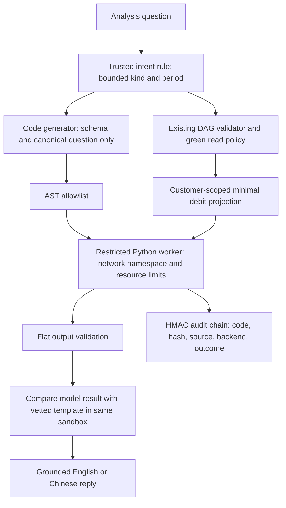

# Restricted Python spending analysis

This adds read-only execution of generated Python for spending questions. It
does not retrain or replace r3 and is not part of the live app.

## Pipeline



The code generator gets no ledger values, account context, customer wording,
names, phone numbers, balances or dates. A canonical question prevents unknown
personal information in nominally tokenized text from reaching the model. The
worker receives only `day`, `weekday`, `hour`, positive integer `amount_fen` and
`category`. Income and own-savings transfers are excluded. Queries are scoped to
the authenticated customer's bank and selected period. The generated language
has no bank, network, credential or payment capabilities.

Supported computations are weekend versus weekday, four time-of-day buckets,
and weekday totals and averages. A generic analysis request currently selects the
weekday analysis; this is not an arbitrary-question coding agent. Averages are
per observed spending day, excluding days without spending, and use integer fen
with half-up rounding. Hour buckets are midnight to before six, six to before
noon, noon to before six in the evening, and six in the evening to before
midnight.

## Generation and verification

`ANBAN_CODEGEN_URL` and `ANBAN_CODEGEN_MODEL` select an OpenAI-compatible code
endpoint. Without them, the existing `ANBAN_LOCAL_URL` / `ANBAN_LOCAL_MODEL` are
used if configured. With no endpoint, a vetted template is selected. The r3
adapter was trained for banking JSON, so Python generation is not assumed.

An optional `ANBAN_CODEGEN_API_KEY` is sent only to an explicitly configured
codegen URL, never to the planner URL fallback. Set it privately in the launcher;
do not put credentials in source or demo commands. Proxy inheritance and
redirects are disabled. Requests use temperature zero, at most six hundred output
tokens, a bounded timeout and disabled Qwen thinking.

AST-invalid, failed or unavailable generation falls back to a labelled template.
A model-written program that executes successfully must still match the vetted
calculation, including exact JSON types. Otherwise the template result is used.
Both programs run through the same restrictions and each attempt is audited.
There is no in-process `exec` fallback. Model refusal prose and exceptions are
never shown as financial results.

## Isolation boundary

The backend actually verified on a development laptop is `wsl-unshare`, using
the existing Ubuntu-22.04 distribution. Linux uses `unshare` and `prlimit`.
Missing or denied namespace support returns `unavailable`; it does not silently
execute plain Python.

The fixed worker uses `python -I -S`, a reduced builtin set, restricted imports,
an empty application environment, a temporary working directory, bounded input
and output, wall-clock timeout, address-space and CPU limits. Linux also limits
file size, open descriptors, processes and core dumps. On Windows, the WSL
launcher receives only the OS `SystemRoot`; `env -i` clears the Linux worker's
environment. Discovery is cached and has a separate cold-start budget.

This is not a filesystem jail, container or arbitrary-Python execution service.
User and network namespaces isolate networking. Filesystem access is denied by
the restricted language, allowlisted attributes and imports, and missing
capabilities; the host filesystem is not hidden by a mount namespace. Hostile
third-party packages must not be installed or run here. Killing a Windows WSL
launcher is not a guarantee of immediate Linux-worker termination; worker CPU
and memory limits provide additional bounds. A future general-purpose coding
agent needs a stronger filesystem and syscall boundary.

`ANBAN_SANDBOX_DEV=1` explicitly enables `subprocess-dev` for tests. Windows dev
mode has a timeout but no Linux OS memory or network limits. Replies and audit
events identify development mode rather than claiming isolation.

## Local demonstration

From this worktree in PowerShell:

```powershell
..\AnBan\.venv\Scripts\python scripts/demo_sandbox.py
..\AnBan\.venv\Scripts\python scripts/demo_sandbox.py --question "What time of day do I spend the most?"
..\AnBan\.venv\Scripts\python scripts/demo_sandbox.py --lang zh --question "周末和工作日花钱有什么不同？"
```

Linux with the project dependencies installed:

```bash
python scripts/demo_sandbox.py
```

These commands create a fresh synthetic in-memory bank and use an injected clock.
They never open or reset the live demo database. By default, generation is a
template unless a codegen endpoint is configured. `--dev` explicitly selects an
unisolated development worker. Audit output identifies the actual source.

## Verification

Final validation: **2,044 Python tests passed**, including actual
WSL network isolation and checked-code execution; no tests were skipped.

Tests cover forbidden constructs and module mutation, minimal input and output
schemas, resource exhaustion, bounded streams, namespace networking, actual WSL
execution, privacy, read-only bank state, multilingual routing, grounding,
generation failures and semantic mismatch. A live code-generation request also
produced a new hourly-analysis program, which executed under `wsl-unshare` and
agreed with the vetted computation; its audit chain verified.

The r3 system prompt remains byte-identical (SHA-256
`f290a64c7081de21eeabbf883141644101539f909ecbee2b8d2e2d4af6db40c0`).
The prompt generator omits the rule-routed sandbox tool from the r3 tool list,
while the fallback registry includes it. No changes are required to `training/`,
`bank/seed.py`, `agent/graph.py` or `security/policy.py`.

## Limitations

- `security/sandbox.py` and `security/audit.py` still need a formal penetration
  test. `security/audit.py` adds `SANDBOX` events, plain-language display and an
  internal computed fingerprint type. External strings remain subject to the PII
  guard; a hex-looking string or metadata key does not bypass it. Proposals
  containing phone or account-looking literals are rejected and their code is
  redacted while the computed hash remains logged.
- The production deployment host still needs its own namespace availability
  check and security review. The laptop proof does not mean the live app or
  remote GPU server has been upgraded.
- The worker is not a filesystem jail, container or service for running
  arbitrary Python, as described under the isolation boundary.
